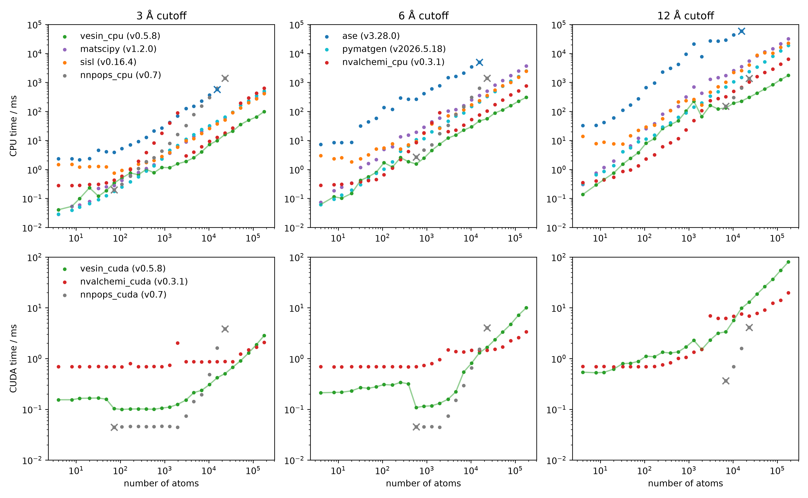

# Vesin: fast neighbor lists for atomistic systems

[](http://luthaf.fr/vesin/)


| English 🇺🇸⁠/⁠🇬🇧 | Occitan  | Arpitan  | French 🇫🇷 | Gallo‑Italic  | Catalan  | Spanish 🇪🇸 | Italian 🇮🇹 |
|------------------|----------|-----------|----------|--------------|---------|------------|------------|
| neighbo(u)r      | vesin    | vesin     | voisin   | visin        | veí     | vecino     | vicino     |


Vesin is a fast and easy to use library computing neighbor lists for atomistic
systems, with CPU and GPU support. We provide an interface for the following
programing languages and frameworks:

- C (compatible with C++). The code can be used as an external library, or
  included as a single file and built directly by your own build system;
- Fortran;
- Python;
- PyTorch, supporting both `torch.compile` and TorchScript;
- Jax

### Installation

To use the code from Python, you can install it with `pip`:

```
pip install vesin
pip install vesin-torch  # for PyTorch support
pip install vesin-jax    # for Jax support
```

See the [documentation](https://luthaf.fr/vesin/latest/index.html#installation)
for more information on how to install the code and use it.

### Usage instruction

You can either use the `NeighborList` calculator class:

```py
import numpy as np
from vesin import NeighborList

# positions can be anything compatible with numpy's ndarray
positions = [
    (0, 0, 0),
    (0, 1.3, 1.3),
]
box = 3.2 * np.eye(3)

calculator = NeighborList(cutoff=4.2, full_list=True)
i, j, S, d = calculator.compute(
    points=positions,
    box=box,
    periodic=True,
    quantities="ijSd",
)
```

### Benchmarks

You can find below benchmark result computing neighbor lists for increasingly
large diamond supercells, using an AMD EPYC 9334 CPU and an NVIDIA H100 GPU. You
can run this benchmark on your system with
`python -m benchmarks.run` (from the repository root). Cross on points indicate
that a specific code could
not run the calculation after or before the cross (for example, NNPOps requires
the cell to be twice the cutoff in size, and can't run with large cutoffs and
small cells).



## License

Vesin is is distributed under the [3 clauses BSD license](LICENSE). By
contributing to this code, you agree to distribute your contributions under the
same license.

## Citation

If you found ``vesin`` useful, you can cite the article where it was presented
(<http://doi.org/10.1063/5.0304911>) as

```bibtex
@article{metatensor-and-metatomic,
  title = {Metatensor and Metatomic: Foundational Libraries for Interoperable Atomistic Machine Learning},
  volume = {164},
  ISSN = {1089-7690},
  url = {http://doi.org/10.1063/5.0304911},
  DOI = {10.1063/5.0304911},
  number = {6},
  journal = {The Journal of Chemical Physics},
  publisher = {AIP Publishing},
  author = {Bigi,  Filippo and Abbott,  Joseph W. and Loche,  Philip and Mazitov,  Arslan and Tisi,  Davide and Langer,  Marcel F. and Goscinski,  Alexander and Pegolo,  Paolo and Chong,  Sanggyu and Goswami,  Rohit and Febrer,  Pol and Chorna,  Sofiia and Kellner,  Matthias and Ceriotti,  Michele and Fraux,  Guillaume},
  year = {2026},
  month = Feb
}
```
